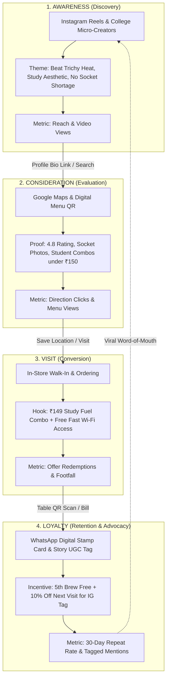

# Full-Funnel Marketing & Channel Strategy: Brew & Bites (Trichy)

**Target Market:** Trichy (Thillai Nagar, Cantonment, Student Corridors)  
**Primary Audience:** College Students (18–22) & Young Professionals (23–30)  
**Core Objective:** Convert passive online scrollers across Trichy into recurring weekly café patrons and brand advocates.

---

## 1. Funnel Overview & Architecture

The strategy moves prospects through 4 distinct stages, systematically removing friction at each handoff point:

---

## 2. Deep-Dive by Funnel Stage

### Stage 1: Awareness (Top of Funnel - TOFU)
* **Objective:** Establish Brew & Bites as Trichy’s coolest, high-productivity coffee destination.
* **Primary Channel:** **Instagram Reels** (Organic + Geotargeted Boosts within 10 km radius of Thillai Nagar/colleges).
* **Secondary Channel:** Campus micro-creators from local colleges (NIT Trichy, Bishop Heber, St. Joseph's, Holy Cross).
* **Content Hooks:**
  * *"Tired of cafes in Trichy with zero plug points? We fixed that."*
  * *"Escaping 39°C Trichy heat with a ₹149 iced cold brew."*
  * *"Where to study in Trichy when hostel Wi-Fi goes down."*
* **Primary KPI:** **Local Account Reach & 3-Second Video View Rate**
* **Target Benchmark:** 45,000+ local accounts reached per month; >25% completion rate on 15s reels.
* **Friction Buster:** Include exact landmark text ("Opposite X, 3rd Cross Thillai Nagar") directly on video overlays so viewers know it's local.

---

### Stage 2: Consideration (Middle of Funnel - MOFU)
* **Objective:** Give hesitant students the immediate proof they need to pick Brew & Bites over CCD or local bakeries.
* **Primary Channel:** **Google Business Profile (GBP / Google Maps)**.
* **Secondary Channel:** Instagram Highlights ("Menu & Prices", "Study Setup", "Directions").
* **Key Assets Provided:**
  * High-definition photos of spacious study tables with power outlets visible.
  * Transparent published menu pricing (no hidden service charges or taxes - Status: Assumption).
  * Direct WhatsApp chat button for instant questions or table reservations for group project meetups.
* **Primary KPI:** **Google Maps 'Request Directions' & 'View Menu' Clicks**
* **Target Benchmark:** 650+ direction requests per month; >18% conversion from search impression to action.
* **Friction Buster:** Display transparent price badges on Google Maps photos (e.g., *"Cold Brew starting at ₹119"*).

---

### Stage 3: Visit / First Purchase (Bottom of Funnel - BOFU)
* **Objective:** Turn digital intent into a physical walk-in customer.
* **Primary Channel:** **Point-of-Sale (POS) & First-Timer Campus Pass**.
* **Conversion Offer:**
  * **The "Study Fuel Combo":** Iced Brew + Savory Garlic Herb Toastie for **₹149** upon flashing a valid college ID card.
  * **The "Gang Split Platter":** Loaded Wedges + Dip Platter for **₹199** (serves 3–4 friends).
* **In-Store Experience Hook:**
  * Immediate QR code on tables for auto-connecting to 100 Mbps fiber Wi-Fi.
  * Free water carafe stations (no pressure to buy bottled mineral water).
* **Primary KPI:** **First-Time Promo Redemptions & Total Weekly Footfall**
* **Target Benchmark:** 200+ combo redemptions per week; 30% of footfall ordering the featured combo.
* **Friction Buster:** Eliminate minimum order values or mandatory seat charges—students are free to stay with a single coffee.

---

### Stage 4: Loyalty & Advocacy (Post-Purchase Retention)
* **Objective:** Maximize Customer Lifetime Value (LTV) and ignite organic peer-to-peer referral loops.
* **Primary Channel:** **WhatsApp Digital Loyalty Card** (No app download required; powered by phone number).
* **Secondary Channel:** User Generated Content (UGC) Instagram Story Tags.
* **Retention Mechanism:**
  * **The "5-Stamp Card":** Buy 4 specialty brews, get the 5th brew completely free.
  * **Tag-to-Treat:** Tag `@brewandbites.trichy` in your study reel/story for an instant 10% discount on your next visit.
  * **Exam Season Care-Pack:** Flash your exam timetable for free double espresso shot upgrades.
* **Primary KPI:** **30-Day Repeat Visit Rate & Instagram UGC Tagged Posts**
* **Target Benchmark:** >35% return rate within 30 days; 40+ user tagged stories per week.
* **Friction Buster:** Zero friction loyalty: Cashier simply inputs the mobile number at billing to auto-send WhatsApp punch updates.

---

## 3. Full Funnel Measurement Matrix

| Funnel Stage | Primary Channel | Core Metric / KPI | Industry Benchmark | Brew & Bites Target | Data Source |
|---|---|---|---|---|---|
| **Awareness** | Instagram Reels | Local Unique Accounts Reached | 15k - 25k / mo | **45k+ / month** | Meta Professional Dashboard |
| **Consideration** | Google Maps (GBP) | 'Directions Requested' Clicks | 8% - 12% of searches | **>18% search-to-action** | Google Business Profile Insights |
| **Visit** | In-Store POS | Student Combo Redemptions | 10% - 15% ticket mix | **30% of total transactions** | POS Sales & Coupon Reports |
| **Loyalty** | WhatsApp Loyalty | 30-Day Customer Repeat Rate | 20% - 25% | **>35% repeat within 30 days** | CRM / WhatsApp Stamp Database |

---

## 4. Why This Funnel Wins in Trichy

1. **Leverages Tier-2 Local Dynamics:** In Trichy, word-of-mouth travels through tight-knit college circles (NITT hostels, Bishop Heber campus groups). A student who feels respected and gets fast Wi-Fi will bring 3 batchmates the next day.
2. **Eliminates High-App Download Friction:** Competitors often fail by forcing customers to install heavy apps. By pairing Instagram discovery with WhatsApp loyalty, there is zero friction for college students.
3. **Connects Attention to Cash Flow:** Every piece of awareness content (Reel) connects directly to a commercial trigger (Google Maps directions $\rightarrow$ ₹149 combo $\rightarrow$ WhatsApp stamp).
